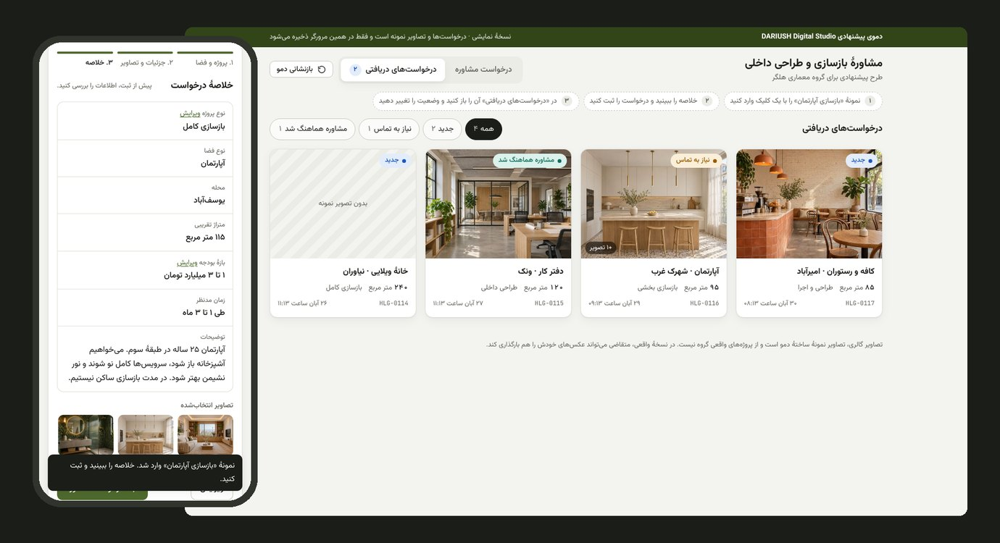

<div align="center">
  <h1>Renovation &amp; Interior Design Consultation Demo</h1>
  <p><b>A Persian, right-to-left web demo: a two-step consultation form with a sample photo gallery and a summary before submitting, plus an inbox of incoming projects.</b></p>
  <p>Proposal demo by <b>DARIUSH Digital Studio</b> for <b>Helger Architecture Group</b> · requests and photos are samples</p>
  <p>
    <a href="https://dariush-tech.github.io/helger-consult-demo/"><b>Live demo</b></a> ·
    <a href="#demo-flow">Demo flow</a> ·
    <a href="#run-locally">Run locally</a>
  </p>
  <p>
    
    
    
    
    
  </p>
  
</div>

<div dir="rtl">

### خلاصه

دموی پیشنهادی DARIUSH Digital Studio برای گروه معماری هلگر. متقاضی در دو مرحلهٔ کوتاه نوع پروژه، نوع فضا، محله، متراژ تقریبی، بازهٔ بودجه (اختیاری)، زمان مدنظر و توضیحات را وارد می‌کند و تا سه تصویر نمونه از گالری دمو انتخاب می‌کند. پیش از ثبت، خلاصهٔ درخواست نمایش داده می‌شود. در «درخواست‌های دریافتی»، کارت هر پروژه با نوع فضا، محله، متراژ و تصویر بندانگشتی دیده می‌شود و وضعیت بین «جدید»، «نیاز به تماس» و «مشاوره هماهنگ شد» تغییر می‌کند. نمونهٔ «بازسازی آپارتمان» با یک کلیک وارد می‌شود.

</div>

## Demo flow

1. **Enter the sample.** One tap on «ورود نمونهٔ بازسازی آپارتمان» fills both steps (full renovation, apartment, Yousef-Abad, 115 m², budget, timing, notes and three gallery photos) and opens the summary.
2. **Review and submit.** The summary lists every answer with links back to each step. Submitting shows a reference such as `HLG-0119`.
3. **Open it in the inbox.** The new request opens straight away as a card and a detail sheet with its photos, answers, status switch and history.

## Features

- **Two short steps** with inline Persian validation: project type, space type, neighbourhood (with suggestions) and area first; budget (optional), timing, notes and photos second. Area accepts Persian or Latin digits.
- **Sample photo gallery** of eight interiors; up to three can be picked, and the selection order is numbered on each photo.
- **Summary before submitting**, with edit links back to the right step.
- **Project cards** led by the first selected photo, with space type, neighbourhood, area, project type, status and a photo count; cards without photos show a neutral placeholder.
- **Detail sheet** (bottom sheet on phones) with the selected photos, all answers, a three-state status switch and a timestamped history; filters by status with live counts.
- **Local persistence and reset.** Requests are saved in `localStorage` and sync across open tabs; the reset button restores the four sample requests after an in-page confirmation.
- Persian calendar dates, light and dark themes, phone layouts and keyboard-accessible controls.

## Project structure

```
helger-consult-demo/
├── index.html      # markup, styles and scripts (single file, no build step)
├── img/            # gallery photos (1200×900) and thumbnails (*-t.jpg, 480×360)
└── docs/           # README media
```

## Run locally

```bash
git clone https://github.com/dariush-tech/helger-consult-demo.git
cd helger-consult-demo
python3 -m http.server 8000
# open http://localhost:8000
```

## Notes

- Gallery photos are sample images made for this demo, not projects by Helger Architecture Group.
- All requests are fictional and stay in each visitor's own browser.

---

Design & development: [Dariush Technology](https://github.com/dariush-tech) · DARIUSH Digital Studio
